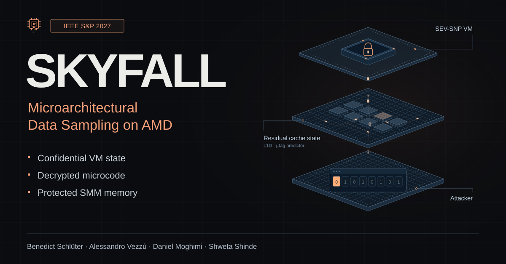

<p align="center">
  <a href="https://skyfall-attack.github.io/">
    
  </a>
</p>

<p align="center">
  <a href="https://skyfall-attack.github.io/"><strong>Website ↗</strong></a> ·
  <a href="https://skyfall-attack.github.io/assets/skyfall.pdf"><strong>Paper ↗</strong></a><br>
  IEEE Symposium on Security and Privacy (S&amp;P), 2027
</p>

SKYFALL samples residual CPU cache data, exposing confidential AMD SEV-SNP guest state, decrypted microcode, and protected System Management Mode memory.

[Benedict Schlüter](https://benschlueter.com/)\*, [Alessandro Vezzù](https://www.linkedin.com/in/avezzu/)\*, [Daniel Moghimi](https://moghimi.org/), and [Shweta Shinde](https://www.shwetashinde.org/).  
\* Equal contribution.

### Citation

```bibtex
@inproceedings{schlueter2027skyfall,
  title = {{SKYFALL}: Microarchitectural Data Sampling on {AMD}},
  author = {Schl{\"u}ter, Benedict and Vezz{\`u}, Alessandro and
            Moghimi, Daniel and Shinde, Shweta},
  booktitle = {2027 IEEE Symposium on Security and Privacy (SP)},
  year = {2027},
  publisher = {IEEE}
}
```

